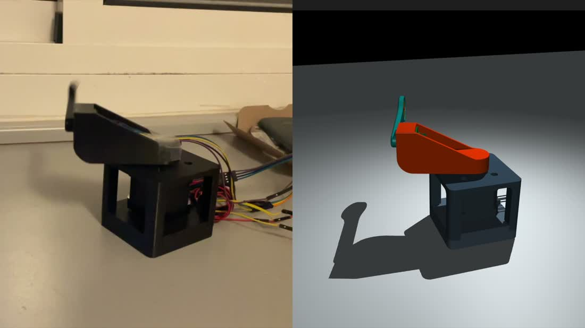

# OpenFuruta

OpenFuruta is an open-source rotary inverted pendulum designed by Alex Latorre. A stepper swings a 3D-printed arm around a vertical axis. The pendulum swings freely at the end of the arm, with a 50-cent coin as its counterweight. An ESP32 reads two magnetic encoders and controls swing-up, upright balance and return to center.

## Build one

1. Get the [parts](hardware/BOM.csv) and download the [assembly STEP](hardware/cad/OpenFuruta.step) and [printable STLs](hardware/print/).
2. Follow the [printing and assembly guide](docs/build.md).
3. Wire the [ESP32, driver, motor and encoders](hardware/electronics/README.md).
4. [Flash, calibrate and commission the firmware](firmware/README.md).

## Run it on your computer

~~~sh
python3.12 -m venv .venv
source .venv/bin/activate
python -m pip install -r sim/requirements.txt
python sim/verify.py
~~~

The [simulation guide](sim/README.md) covers interactive MuJoCo, the included reinforcement-learning policy and the C++ firmware simulation.

## Prototype results

The v2 approach controller completed swing-up, a firmware-confirmed 30-second hold, and return to center in **4 of 5** physical attempts on November 13 and **2 of 5** on November 16. A predictive-braking variant met the additional sub-10-second swing-up target in **5 of 5** held-out simulated cases. It completed **0 of 5** full cycles in the subsequent hardware test. [Trial reports, raw telemetry and reproduction steps](docs/validation.md).

The STEP records the prototype geometry, and the printable meshes have been checked digitally. Print fits, encoder mounting and the complete build procedure still need a second-build check.

## License

Original firmware, simulation code and software tools are available under [MIT](LICENSE). Original CAD, print files, wiring, build documentation and project media are available under [CERN-OHL-P-2.0](licenses/CERN-OHL-P-2.0.txt). Purchased components and linked vendor documents have their respective manufacturers' terms. See [design provenance](hardware/cad/README.md).
