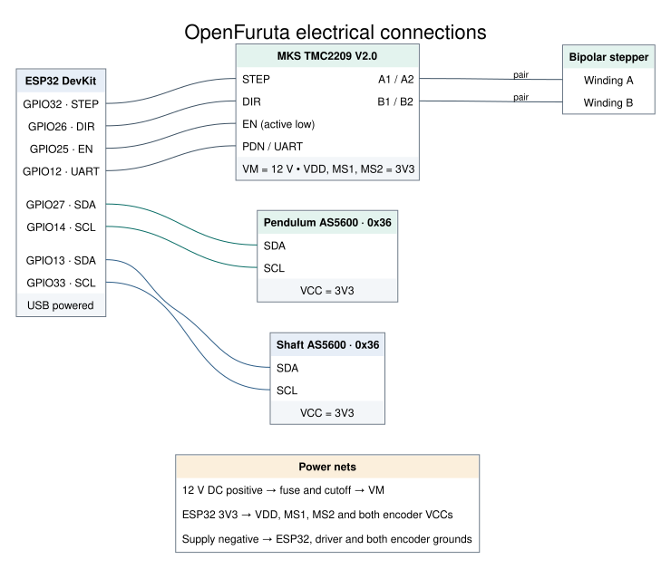

# Electrical schematic

[Editable schematic](wiring.dot) · [Connection list](nets.csv). This is a point-to-point module build. Each line is one signal except the motor winding pairs. Run **dot -Tsvg wiring.dot -o wiring.svg** in this directory to regenerate the drawing.

| Connection | ESP32 | Module |
| --- | --- | --- |
| Enable, active low | GPIO25 | TMC2209 EN |
| Step | GPIO32 | TMC2209 STEP |
| Direction | GPIO26 | TMC2209 DIR |
| Single-wire UART, 9600 baud | GPIO12 | TMC2209 PDN/UART |
| Pendulum I²C, 100 kHz | SDA GPIO27, SCL GPIO14 | Upper AS5600 |
| Shaft I²C, 100 kHz | SDA GPIO13, SCL GPIO33 | Lower AS5600 |
| 3.3 V logic | 3V3 | Driver VDD/VIO, MS1 and MS2, both encoder supply pins |
| Common ground | GND | Both driver grounds, both encoders and 12 V supply negative |
| Motor supply | USB powers ESP32 separately | Fused and switched 12 V positive to driver VM |
| Motor windings | — | One verified coil pair to A1/A2 and the other to B1/B2 |

Both encoders have address **0x36**. They each need an independent I²C bus with pull-ups to 3.3 V, often provided by the breakout. Verify the breakout pin labels and schematic. Route I²C wires away from motor windings and keep them short where possible. Verify the exact carrier pinout, especially VM and VDD.

On the MKS TMC2209 V2.0 carrier, both MS pins high select UART address 3 and 16 external microsteps in pin-configured mode. The firmware expects 3200 pulses per revolution with a 200-step motor. GPIO12 is an ESP32 boot strap. Remove any external PDN/UART strap. If substituting another carrier, verify that GPIO12 stays low at reset. The firmware verifies UART communication and configuration before enabling motion. Check the carrier's phase current and cooling against your motor. The UART register values in firmware describe this prototype.

Disconnect USB and motor power before changing wiring or connecting motor windings. Identify the coil pairs and check for shorts with a meter. Power the ESP32 from USB first and verify encoder readings with motor power disconnected. Keep the motor power cutoff outside the sweep area and within reach.

- [Makerbase carrier schematic and pinout](https://github.com/makerbase-mks/MKS-StepStick-Driver/tree/master/MKS%20TMC2209/MKS%20TMC2209%20V2.0_001)
- [Analog Devices TMC2209 datasheet](https://www.analog.com/en/products/TMC2209.html)
- [ams OSRAM AS5600 product documentation](https://ams-osram.com/products/sensors/position-sensors/ams-as5600-position-sensor)
